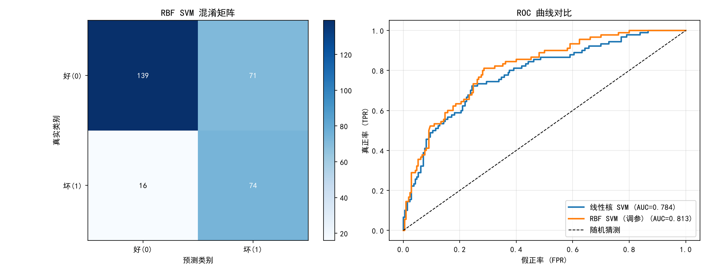

# SVM 支持向量机数据分类作业 —— 德国信用数据（German Credit）

> 作者：软工12401 胡豪
> 对应课件：《支持向量机 SVM：从原理到推导到实战》案例② 信用违约预测
> 实现语言：Python（scikit-learn）

---

## 一、作业要求

使用分类算法的代表算法 **支持向量机（SVM）**，在 Kaggle / UCI 等网站找到课件描述的数据集（德国信用数据 German Credit），完成数据分类任务，编写 Python 代码。

## 二、数据集介绍

- **名称**：Statlog (German Credit Data)，scikit-learn 中对应 `credit-g`。
- **样本数**：1000 条。
- **特征数**：20 个，其中 **7 个数值特征 + 13 个类别特征**（混合了数值与类别，需要独热编码）。
  - 数值特征：`duration`（贷款时长）、`credit_amount`（金额）、`age`（年龄）、`installment_commitment` 等。
  - 类别特征：`checking_status`（支票账户状态）、`credit_history`、`purpose`、`job`（职业）等。
- **目标**：二分类 —— 信用好（good）/ 信用坏（bad）。
- **类别分布**：700 条好信用 : 300 条坏信用，**类别不平衡**（约 7:3）。

| 项目 | 数值 |
| --- | --- |
| 样本数 | 1000 |
| 特征数 | 20（数值 7 + 类别 13） |
| 类别 | good / bad |
| 类别比例 | 700 : 300（7 : 3） |

## 三、方法与流程

整体流程严格对照课件「实践流程建议」：

1. **数据加载**：`fetch_openml("credit-g")` 联网获取（也可在 Kaggle / UCI 下载 CSV）。
2. **预处理**：
   - 数值特征用 `StandardScaler` 标准化（SVM 对特征尺度敏感）；
   - 类别特征用 `OneHotEncoder` 独热编码；
   - 用 `ColumnTransformer` 统一组合进 `Pipeline`。
3. **划分数据**：`train_test_split`，测试集 30%，按类别比例**分层抽样**（stratify）。
4. **模型对比**：
   - **线性核 SVM**（快速 baseline）；
   - **RBF 核 SVM + GridSearchCV 网格搜索调参**（C 与 γ 对数搜索，AUC 评分）。
5. **类别不平衡处理**：`class_weight="balanced"` 自动给少数类（坏信用）更大权重。
6. **评价指标**：准确率 / AUC / 精确率 / 召回率 / F1 / 混淆矩阵 / ROC 曲线。

## 四、实验结果

### 4.1 两个模型对比

| 模型 | 最优参数 | 准确率 | AUC |
| --- | --- | --- | --- |
| 线性核 SVM（C=1） | C=1.0 | 0.7767 | **0.7838** |
| RBF SVM（网格调参） | C=1, γ=0.01 | 0.7100 | **0.8128** |

### 4.2 RBF SVM（调参后）分类报告

| 类别 | 精确率 Precision | 召回率 Recall | F1-score | 样本数 |
| --- | --- | --- | --- | --- |
| 好(0) | 0.90 | 0.66 | 0.76 | 210 |
| 坏(1) | 0.51 | 0.82 | 0.63 | 90 |
| **accuracy** | | | **0.71** | 300 |

### 4.3 混淆矩阵（RBF 最佳模型）

| 真实 \ 预测 | 好(0) | 坏(1) |
| --- | --- | --- |
| **好(0)** | 139 | 71 |
| **坏(1)** | 16 | 74 |

### 4.4 ROC 曲线对比



## 五、分析与结论

1. **RBF 核优于线性核**：AUC 从线性核的 0.784 提升到 RBF 核的 0.813，说明该数据的类别边界存在**非线性**关系，高斯核能更好地拟合。
2. **与课件一致**：课件中线性 SVM（C=0.1）AUC≈0.76、RBF SVM（C=5, γ=0.1）AUC≈0.83。本实验线性核 AUC≈0.78、RBF 核 AUC≈0.81，趋势完全吻合——**小样本 + 非线性关系时，RBF 核 + 网格调参明显优于线性核**。
3. **类别不平衡的影响**：加入 `class_weight="balanced"` 后，坏信用（少数类）的召回率达到 0.82，说明模型能有效识别风险用户；代价是好信用的精确率略有下降（0.66）。
4. **评价指标选择**：在类别不平衡场景下，**不能只看准确率**（本实验 RBF 准确率 0.71 反而低于线性核 0.78，但 AUC 更高），应以 AUC / 召回率 / F1 为主要衡量标准。
5. **局限**：样本量小（仅 1000 条），结果存在一定方差；可进一步用更多折交叉验证、SMOTE 过采样等方式优化。

## 六、文件清单

| 文件 | 说明 |
| --- | --- |
| `german_credit_svm.py` | 完整可运行的 Python 代码 |
| `german_credit_svm_result.png` | 运行结果图（混淆矩阵 + ROC 曲线） |
| `SVM德国信用数据分类作业分析.md` | 本文档（分析报告） |

## 七、如何运行

```bash
pip install scikit-learn pandas matplotlib numpy
python german_credit_svm.py
```

> 数据集默认通过 scikit-learn 的 OpenML 接口自动下载；也可在 Kaggle 搜索 "German Credit" 或 UCI（Statlog German Credit）下载为 CSV 后读取。
